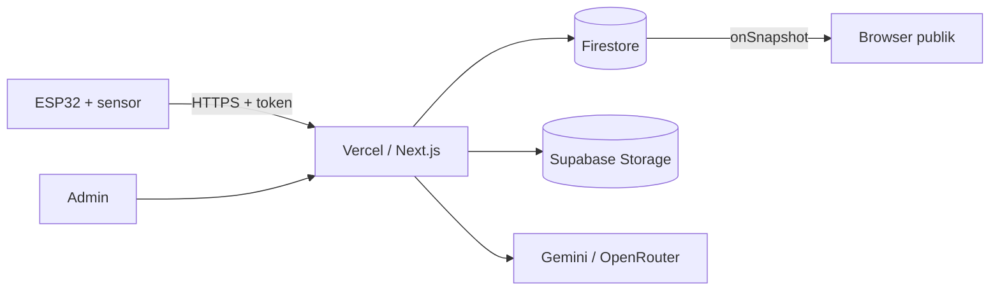

# SmartGloves

Prototipe sarung tangan pintar yang menerjemahkan isyarat tangan SIBI menjadi teks dan suara,
dengan website untuk tampilan langsung, kamus isyarat, latihan, dan pengelolaan oleh admin.

> Prototipe edukasi, bukan pengganti juru bahasa isyarat. Cakupan: satu tangan, huruf dan kata dasar SIBI.

## Fitur
- Demo live: teks real-time, suara dari browser, riwayat kalimat, skor kecocokan pose
- Kamus isyarat dengan pencarian dan filter kategori
- Latihan: level bertahap, Time Attack, Eja Kata dengan koreksi ejaan (Levenshtein)
- Tanya SmartGloves: asisten AI yang menjawab dari isi situs
- Admin: kata (CRUD), Mode Rekam pose, audio, halaman informasi, asisten AI, cadangan, log

## Arsitektur

## Menjalankan
1. `npm install`
2. Salin `.env.example` menjadi `.env.local`, lalu isi nilainya
3. `npm run dev`, buka http://localhost:3000
4. `npm test` untuk tes otomatis

## Keamanan singkat
- Penulisan data hanya lewat server (Firebase Admin SDK), klien hanya boleh membaca event
- Admin memakai custom claim, perangkat memakai token, endpoint publik dilindungi CAPTCHA dan batas pemakaian
- Pertanyaan pengunjung tidak disimpan, alamat IP hanya dalam bentuk hash

## Batas layanan gratis
Firestore (Spark), Vercel (Hobby), Supabase (Free), Gemini dan OpenRouter (tier gratis). Semua punya kuota
harian, dan situs menyediakan penjaga kuota untuk event dan asisten AI.

## Status
- Web: berjalan
- Firmware ESP32: belum ada

## Dokumentasi teknis
- Kontrak API untuk firmware: `docs/KONTRAK_FIRMWARE.md`

## Daftar periksa sebelum presentasi
- Buka situs 5 menit sebelumnya supaya server tidak dingin, lalu cek `/api/health`
- Admin > Ringkasan: bagian "Perlu perhatian" kosong
- Admin > Perangkat: sarung tangan online. Hapus catatan "simulator"
- Buka dashboard Supabase supaya proyek aktif
- Sisa kuota event dan AI hari ini masih cukup (Ringkasan)
- Ruleset di perangkat sudah versi terbaru, audio terunduh
- Siapkan hotspot ponsel sebagai cadangan WiFi, dan pastikan suara lokal tetap berbunyi
- Siapkan video rekaman demo sebagai cadangan
- Unduh cadangan data (Admin > Cadangan)
- Token dan kunci tidak terlihat di layar atau slide
- Buka `/live` dalam layar penuh dan cek volume

## Tim
1. Azizah
2. Fatin 
3. Pivel
4. Reza